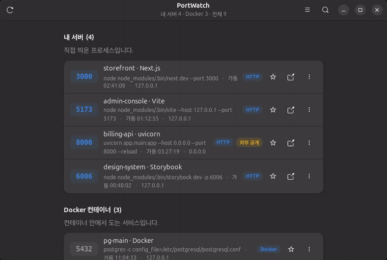
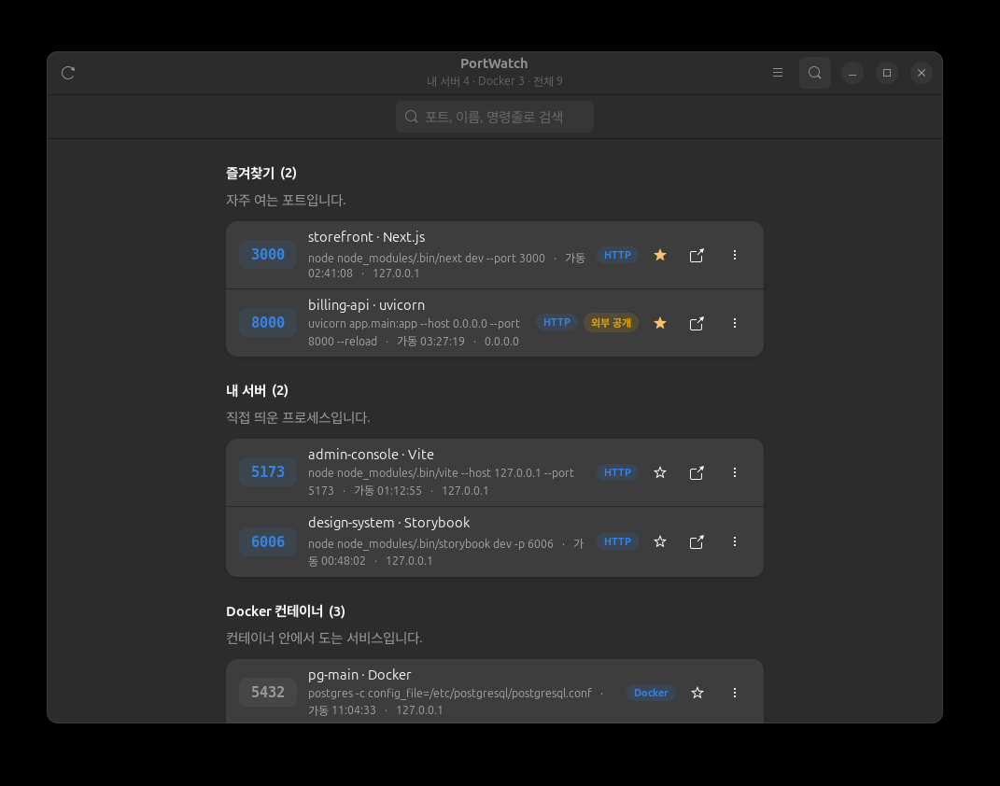
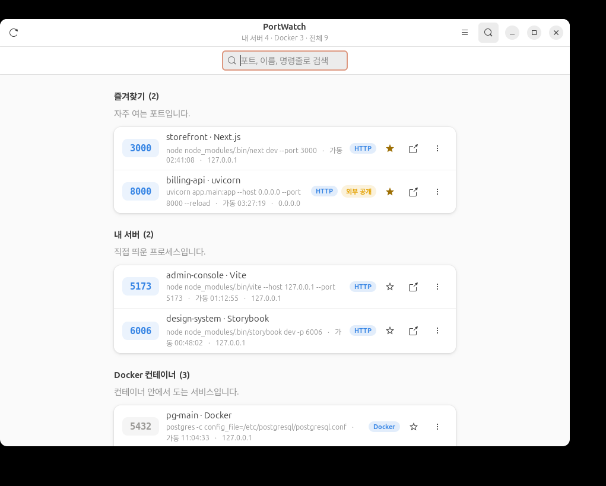

<div align="center">

# PortWatch

**이 컴퓨터가 열어 둔 포트를 한눈에 보고, 웹 서버는 클릭 한 번으로 엽니다.**

개발하다 보면 하루에도 몇 번씩 떠오르는 질문이 있습니다.
*"8080번에 떠 있는 게 대체 뭐였지? 누가 띄운 거지?"*

[English README](README.md)



<sub>별을 눌러 고정 · 이름이나 명령줄로 검색 · 클릭해서 브라우저로 열기 · Docker 컨테이너는 이름으로 표시</sub>

</div>

---

## 왜 만들었나

`ss -ltnp`는 포트가 열려 있다는 사실만 알려 줍니다. 5173번이 세 시간 전에 띄운 관리자 콘솔의
Vite 개발 서버라는 것, 6379번 Redis가 같은 네트워크의 모든 장비에서 접근 가능하다는 것,
8000번이 점심 전에 끄려 했던 FastAPI 앱이라는 것까지는 알려 주지 않습니다.

PortWatch는 그 소켓 목록을 읽고 바로 행동할 수 있는 화면으로 바꿔 줍니다.

## 기능

- **생각하는 순서대로 묶어서 보여줍니다** — 즐겨찾기, 내가 띄운 서버, Docker 컨테이너,
  시스템·관리 포트를 각각의 섹션으로 나눕니다.
- **클릭하면 열립니다.** HTTP로 응답하는 행은 기본 브라우저에서 바로 열립니다.
  `localhost:`를 손으로 칠 일이 없어집니다.
- **PID가 아니라 이름으로 보여줍니다.** `package.json`과 작업 디렉터리, 명령줄을 읽어
  `node` 대신 `admin-console · Vite`로 표시합니다.
- **Docker를 이해합니다.** 포트 뒤에 있는 컨테이너 이름을 찾아 `postgres`가 아니라
  `pg-main`으로 보여줍니다.
- **외부 노출을 경고합니다.** `0.0.0.0`이나 `::`에 바인딩된 포트에는 **외부 공개** 표시가
  붙습니다. 노트북의 개발 서버가 사내망에 그대로 열려 있을 이유는 보통 없습니다.
- **프로토콜을 판별합니다.** 각 포트를 한 번만 찔러 보고 HTTP·HTTPS·TCP로 구분하므로,
  PostgreSQL 소켓에 브라우저 탭을 여는 일이 없습니다.
- **즐겨찾기.** 하루 종일 여는 포트 서너 개에 별을 달면 맨 위로 올라옵니다.
- **자동 갱신.** 5초마다 새로 읽되, 실제로 바뀐 것이 있을 때만 화면을 다시 그립니다.
- **네이티브한 모양새.** GTK4와 libadwaita를 쓰고, 시스템의 밝게·어둡게 설정을 따라갑니다.

<div align="center">

&nbsp;

<br>
<sub>시스템의 밝게·어둡게 설정을 그대로 따라갑니다.</sub>
</div>

## 설치

```bash
git clone https://github.com/wntdev99/portwatch.git
cd portwatch
make install
```

가상 환경도, `pip install`도 필요 없습니다. Python 파일 하나를 `~/.local/bin/portwatch`에
복사하고 데스크톱 항목을 등록하므로, 런처에서 "PortWatch"로 검색하면 바로 나옵니다.

제거는 `make uninstall`이며, 실행 파일과 데스크톱 항목, 설정 파일을 모두 지웁니다.

## 사용법

런처에서 실행하거나 터미널에서 `portwatch`를 입력합니다.

| 동작 | 단축키 |
| --- | --- |
| 지금 새로고침 | <kbd>Ctrl</kbd> + <kbd>R</kbd> |
| 포트·이름·명령줄 검색 | <kbd>Ctrl</kbd> + <kbd>F</kbd> |
| 검색 닫기 | <kbd>Esc</kbd> |
| 선택한 서버를 브라우저로 열기 | <kbd>Enter</kbd> |
| 창 닫기 | <kbd>Ctrl</kbd> + <kbd>W</kbd> |

각 행에는 즐겨찾기 별, 브라우저로 열기 버튼, 그리고 *URL 복사*·*명령줄 복사*·
*작업 디렉터리 열기*가 들어 있는 메뉴가 있습니다.

## 요구 사항

- GTK4가 올라간 Linux 데스크톱 (Ubuntu 24.04 / GNOME 46에서 개발·검증)
- Python 3.10 이상
- `python3-gi`, `gir1.2-gtk-4.0`, `gir1.2-adw-1`, 그리고 `iproute2`의 `ss`
- `docker`는 선택 사항이며 컨테이너 이름을 찾는 데에만 씁니다

Ubuntu와 Debian의 기본 GNOME 설치에는 모두 들어 있습니다. 없다면 아래와 같이 설치합니다.

```bash
sudo apt install python3-gi gir1.2-gtk-4.0 gir1.2-adw-1 iproute2
```

## 동작 방식

1. `ss -ltnpH`로 LISTEN 상태인 TCP 소켓을 모두 읽습니다.
2. 소유자를 읽을 수 있는 소켓은 `/proc/<pid>/{cmdline,cwd,cgroup}`에서 명령줄, 작업
   디렉터리, 컨테이너 소속 여부를 채웁니다.
3. 각 포트에 `GET / HTTP/1.0`을 **한 번만** 보내 HTTP·HTTPS·TCP를 판별하고 결과를
   캐시합니다. 그래서 5초 갱신이 부담되지 않습니다.
4. 같은 프로세스의 IPv4·IPv6 행은 하나로 합칩니다.

모든 동작은 현재 사용자 권한으로 이루어집니다. root 권한을 요구하지 않고 시스템에 쓰지 않습니다.

## 설정

설정은 앱이 직접 `~/.config/portwatch.json`에 기록합니다.

```json
{
  "pinned": [3000, 8000],
  "show_system": false,
  "auto_refresh": true
}
```

개발과 스크린샷 촬영을 위한 환경 변수가 두 개 있습니다.

| 변수 | 효과 |
| --- | --- |
| `PORTWATCH_DEMO=1` | 실제 소켓 대신 고정된 가상 데이터를 보여줍니다 |
| `PORTWATCH_COLOR_SCHEME=prefer-light\|prefer-dark` | 시스템 테마 설정을 무시하고 지정한 테마로 띄웁니다 |

## 알려진 한계

- **다른 사용자가 띄운 포트는 "프로세스 정보 없음"으로 나옵니다.** root가 아니면 커널이
  남의 프로세스를 `ss`에 알려 주지 않기 때문입니다. PortWatch는 의도적으로 root로 실행하지
  않으며, 그런 행은 잘 알려진 포트 번호로 서비스를 추정해 표시합니다(`6379 → Redis`).
- **TCP만 봅니다.** UDP 리스너는 표시하지 않습니다. 클릭해서 열고 싶은 것은 대부분 TCP입니다.

## 기여

이슈와 풀 리퀘스트를 환영합니다. PortWatch는 의도적으로 파일 하나로 되어 있으니,
변경은 작게 유지하고 외부 의존성은 추가하지 말아 주세요. 자세한 내용은
[CONTRIBUTING.md](CONTRIBUTING.md)에 있습니다.

## 라이선스

[MIT](LICENSE)
