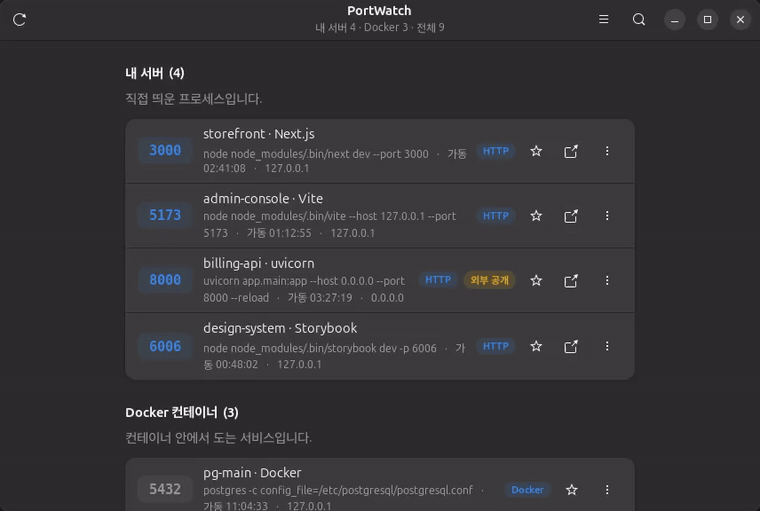
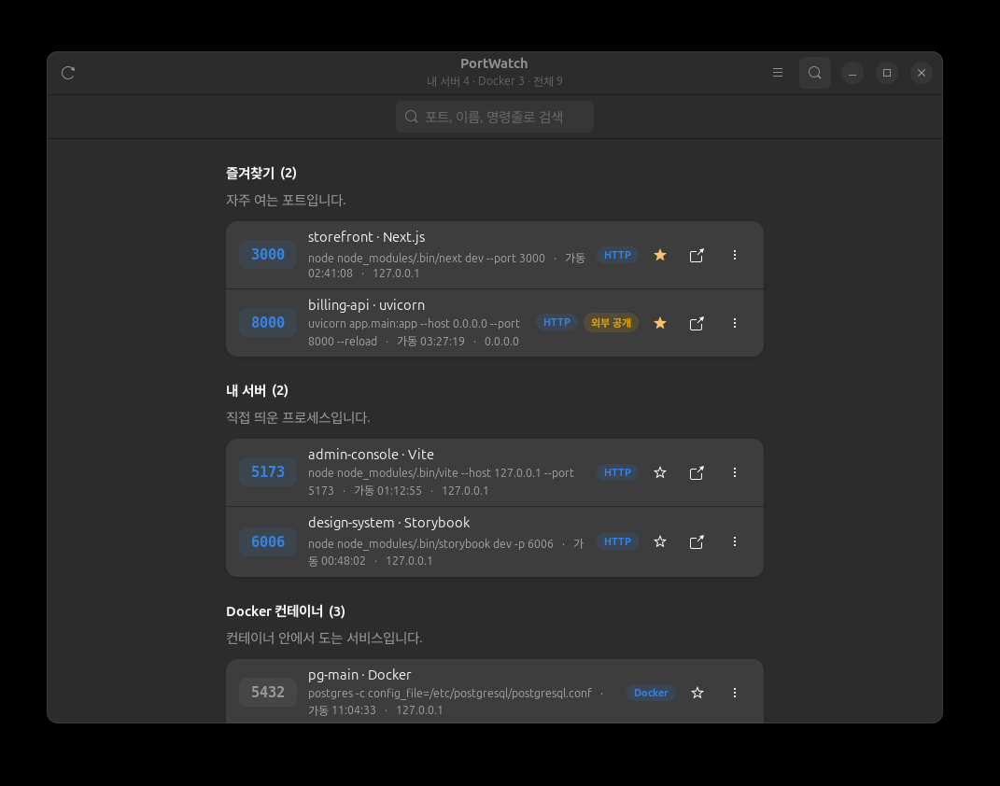
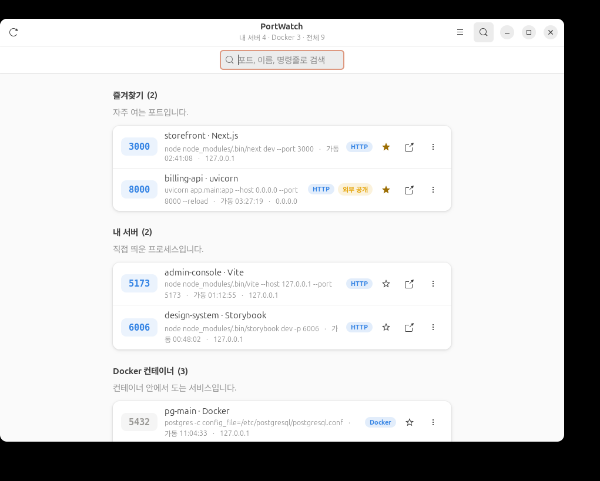
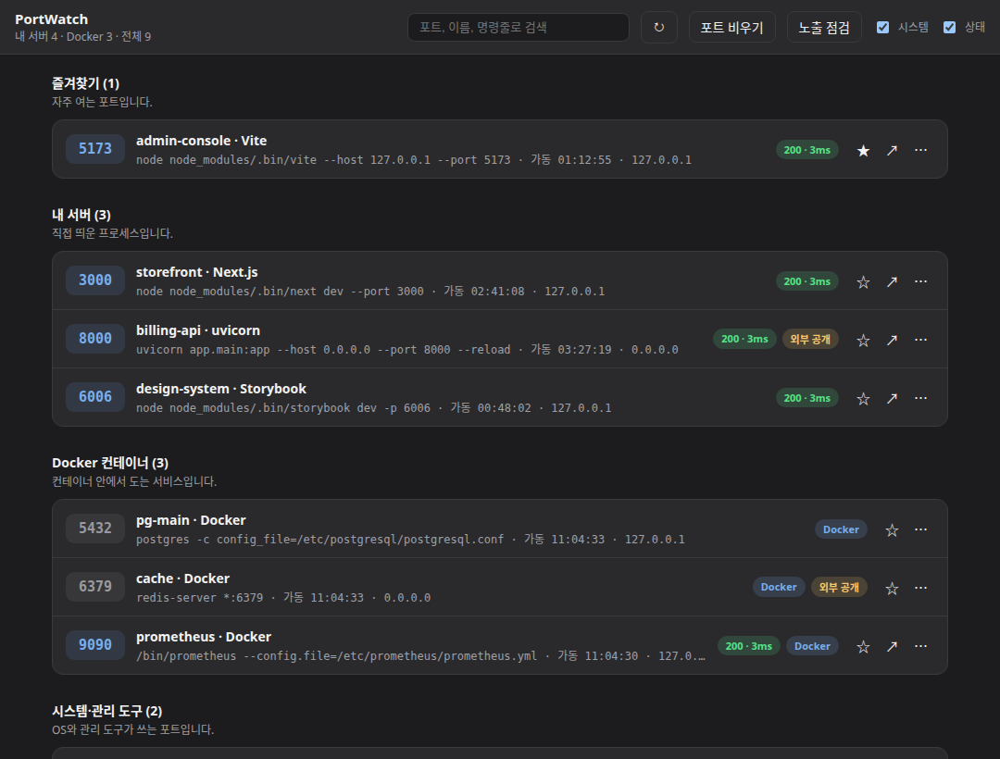

<div align="center">

# PortWatch

**See every port your machine is listening on — and open the web ones in a single click.**

A small, native GNOME app that answers the question every developer asks ten times a day:
*"What is running on port 8080 again, and who started it?"*

[한국어 README](README.ko.md)

[](LICENSE)
[](#requirements)
[](https://gnome.pages.gitlab.gnome.org/libadwaita/)
[](https://www.python.org/)
[](#requirements)



<sub>Star a port · search by name or command line · click to open in the browser · Docker containers resolved by name</sub>

</div>

---

## Why

`ss -ltnp` tells you a port is open. It does not tell you that port `5173` is the Vite dev
server for the admin console you started three hours ago, that `6379` is a Redis container
that is reachable from every machine on your network, or that `8000` is the FastAPI app you
meant to kill before lunch.

PortWatch turns that raw socket list into something you can actually read — and act on.

## Features

- **Everything that listens, grouped the way you think about it** — Favourites, your own
  processes, Docker containers, and system/management ports in separate sections.
- **Click to open.** Any row that speaks HTTP opens in your default browser. No typing
  `localhost:` ever again.
- **Real names, not PIDs.** Reads `package.json`, the working directory and the command line
  to show `admin-console · Vite` instead of `node`.
- **Docker aware.** Resolves the container name behind a port, so you see `pg-main`, not `postgres`.
- **Exposure warnings.** Anything bound to `0.0.0.0` or `::` is flagged **외부 공개**
  (*publicly exposed*), because a dev server on your laptop should usually not be on the LAN.
- **Protocol detection.** Each port is probed once and labelled HTTP, HTTPS or plain TCP,
  so you never open a browser tab against a PostgreSQL socket.
- **Favourites.** Star the three ports you open all day; they float to the top.
- **Stop what you started.** A row you own offers *프로세스 종료* (terminate): a confirmation
  dialog showing the PID, command line and uptime, then `SIGTERM`. If the process is still
  alive three seconds later, PortWatch offers `SIGKILL` rather than sending it silently.
  Rows you do not own and rows inside a container never get the action — containers offer
  *copy `docker stop <name>`* instead.
- **Free a port.** *포트 비우기* (free a port) in the menu: type the port you want, and
  PortWatch finds whoever is holding it and offers to stop it. The answer to
  `Address already in use`, without a round trip through `lsof`.
- **Tells you what changed.** Ports that open or close between refreshes raise a toast, and a
  desktop notification when the window is not focused. Your dev server died quietly? You know.
- **Health at a glance.** Turn on *HTTP 상태 점검* and every HTTP row shows its status code and
  round-trip time — `200 · 12ms`, or an amber `500 · 340ms` for the one that is up but broken.
- **Exposure audit.** *외부 노출 점검* lists every port bound to `0.0.0.0`, and calls out the
  ones that are dangerous unauthenticated — Redis, PostgreSQL, MongoDB, a bare Docker API.
- **Restart what died.** A favourite remembers its command line and working directory, so a
  port that is no longer listening appears under *꺼진 즐겨찾기* with a play button.
- **SSH tunnels, readable.** A port opened by `ssh -L` is shown as
  `SSH 터널 · 8080 → 10.0.0.5:80 (gateway 경유)` instead of a bare `ssh`.
- **Live.** Auto-refreshes every 5 seconds, and only redraws when something actually changed.
- **Native look.** GTK4 + libadwaita, follows your system light/dark preference, keyboard driven.

<div align="center">

&nbsp;

<br>
<sub>Follows your system light/dark preference.</sub>
</div>

## Two screens, one core

PortWatch has a native GTK4 window on Linux and a local web screen everywhere else. Both read
the same core, so a feature exists once and shows up in both.

| | Linux | macOS | Windows |
| --- | :---: | :---: | :---: |
| GTK4 window (`portwatch`) | default | — | — |
| Web screen (`portwatch --web`) | yes | default | default |
| Dependencies | none | `psutil` | `psutil` |

The web screen binds to `127.0.0.1` only, mints a fresh token on every launch, and rejects any
request without that token or carrying a foreign `Origin`. Nothing is exposed to your network.

<div align="center">

<br><sub>The web screen — same sections, same actions, any OS.</sub>
</div>

## Install

**Linux** — no virtualenv, no `pip install`:

```bash
git clone https://github.com/wntdev99/portwatch.git
cd portwatch
make install
```

**macOS and Windows** — `psutil` does the reading there:

```bash
pip install "portwatch[cross] @ git+https://github.com/wntdev99/portwatch"
portwatch            # opens the web screen in your browser
```

<details>
<summary>Run straight from a clone, without installing</summary>

```bash
python3 -m portwatch          # the OS default screen
python3 -m portwatch --web    # force the web screen
PORTWATCH_DEMO=1 python3 -m portwatch   # fake data, for screenshots
```

</details>

<details>
<summary>Uninstall</summary>

```bash
make uninstall       # removes the program, the desktop entry and the config file
```

</details>

## Usage

Launch it from your application grid, or run `portwatch` in a terminal. `--web` forces the
browser screen on any OS, `--port` moves it off 7878, `--no-browser` leaves the tab to you.

| Action | Shortcut |
| --- | --- |
| Refresh now | <kbd>Ctrl</kbd> + <kbd>R</kbd> |
| Search ports, names, command lines | <kbd>Ctrl</kbd> + <kbd>F</kbd> |
| Close search | <kbd>Esc</kbd> |
| Open the selected server in a browser | <kbd>Enter</kbd> |
| Close the window | <kbd>Ctrl</kbd> + <kbd>W</kbd> |

Each row also carries a star (favourite), an **open in browser** button, and a menu with
*copy URL*, *copy command line*, *open working directory* and *open in terminal*. For a
process you own, the menu ends with **프로세스 종료** (terminate), separated from the harmless
entries and guarded by a confirmation dialog.

The main menu holds the tools — *포트 비우기* (free a port) and *외부 노출 점검* (exposure
audit) — and the view switches: system ports, auto refresh, HTTP health checks and change
notifications.

## Requirements

| | |
| --- | --- |
| OS | Linux, macOS 11+, Windows 10+ |
| Python | 3.9 or newer |
| Linux | `ss` (from `iproute2`); for the GTK window, `python3-gi`, `gir1.2-gtk-4.0`, `gir1.2-adw-1` |
| macOS · Windows | `psutil`; `lsof` is the fallback on macOS when `psutil` is missing |
| Optional | `docker`, used only to resolve container names |

On Ubuntu and Debian the GTK pieces are present on a default GNOME install. If not:

```bash
sudo apt install python3-gi gir1.2-gtk-4.0 gir1.2-adw-1 iproute2
```

## How it works

1. Listening sockets come from `ss -ltnpH` on Linux and from `psutil.net_connections` on
   macOS and Windows, falling back to `lsof` when macOS refuses `psutil` without root.
2. Process details come from `/proc/<pid>/{cmdline,cwd,cgroup}` on Linux and from `psutil`
   elsewhere: command line, working directory, owner, uptime, and container membership.
3. Each port is probed **once** with a single `GET / HTTP/1.0` to classify it as HTTP, HTTPS
   or plain TCP. The result is cached, so the 5-second refresh costs nothing.
4. IPv4 and IPv6 rows for the same process are merged into one entry.

```
portwatch/
  core/        collect · probe · actions · platform · config   ← all three OSes
  gtk_app.py   GTK4 + libadwaita window                        ← Linux
  web/         local HTTP server + a single-page screen        ← everywhere
```

Everything runs as your user. PortWatch never asks for root and never writes to the system.

## Configuration

Settings live in `~/.config/portwatch.json` and are written by the app itself:

```json
{
  "pinned": [3000, 8000],
  "show_system": false,
  "auto_refresh": true,
  "check_health": false,
  "notify_changes": true,
  "commands": {
    "3000": {
      "title": "storefront · Next.js",
      "cmdline": "node node_modules/.bin/next dev --port 3000",
      "cwd": "/home/you/work/storefront"
    }
  }
}
```

`commands` is written when you star a port, and is what the restart button replays.
`check_health` is off by default: it sends one `GET /` per HTTP port on every refresh, which
shows up in your dev server's log.

Two environment variables are available, mainly for development and for taking screenshots:

| Variable | Effect |
| --- | --- |
| `PORTWATCH_DEMO=1` | Renders a fixed set of fake services instead of reading real sockets |
| `PORTWATCH_COLOR_SCHEME=prefer-light\|prefer-dark` | Overrides the system light/dark preference |

## Known limitations

- **Ports owned by other users show as "프로세스 정보 없음".** The kernel does not reveal
  another user's process to `ss` unless you are root. PortWatch deliberately does not run
  itself as root; for those rows it falls back to a well-known-port guess (`6379 → Redis`).
- **TCP only.** UDP listeners are not shown. Most things you want to click are TCP.
- **macOS hides other users' sockets.** `psutil.net_connections` needs root there, so without
  it PortWatch falls back to `lsof` and shows the processes you own — which is what you
  actually came for. Running it as root would show everything, and is not recommended.
- **The GTK window is Linux-only.** GTK4 and libadwaita do run on macOS and Windows, but
  asking you to install them through Homebrew or MSYS2 is not a reasonable price for a small
  utility. The web screen exists for exactly that reason.
- **Terminating is limited to your own processes.** PortWatch sends signals as your user and
  never escalates. A container's process is left to `docker stop`, because killing PID 1
  inside a container only triggers its restart policy.
- **The interface is in Korean.** The app was written for a Korean-speaking team.
  Internationalisation is welcome — see [CONTRIBUTING.md](CONTRIBUTING.md).

## Contributing

Issues and pull requests are welcome. PortWatch is deliberately one file; please keep
changes small and dependency-free. See [CONTRIBUTING.md](CONTRIBUTING.md) for the details.

## License

[MIT](LICENSE)
